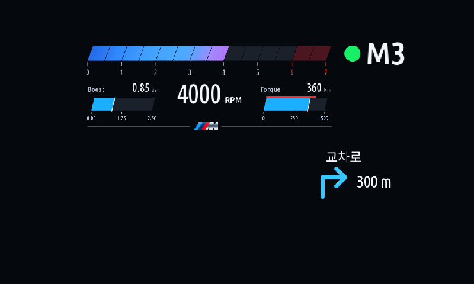
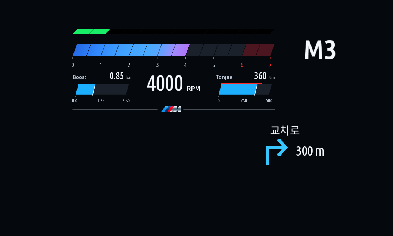
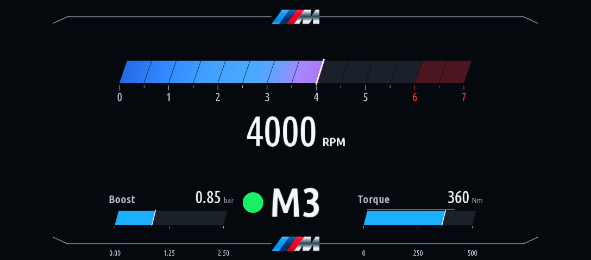
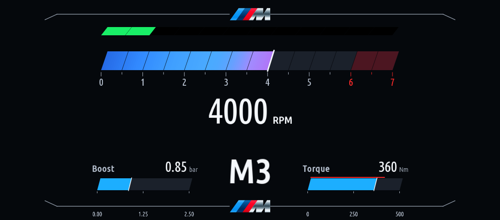

# iDrive 7 Jam Apps

**Cluster Redline 1.2.0** adds separate side metrics/M controls, two cluster/HUD designs, battery/economy readings and combined navigation. **iDrive Circuit 1.0.0** is also available.

[한국어](README.ko.md)

| Documentation | English | 한국어 |
|---|---|---|
| Install | [Installation](docs/INSTALL.md) | [설치 안내](docs/INSTALL.ko.md) |
| Use Redline | [User guide](docs/CLUSTER-REDLINE.md) | [사용 설명서](docs/CLUSTER-REDLINE.ko.md) |
| Use Circuit | [Circuit](apps/idrive_circuit/README.md) | [회로 퍼즐](apps/idrive_circuit/README.ko.md) |

Add MGU Store source **`jaimeen77-cmyk/apps`**, branch **`main`**, refresh and choose Korean or English. Redline requires **`cluster-render` 0.4.0+**. Update existing installs in Installed and check **v1.2.0** in the app. Stop and disable auto-start in an unused language edition if both are installed.

| HUD circle | HUD bar |
|---|---|
|  |  |

| Cluster circle | Cluster bar |
|---|---|
|  |  |

[All screenshots: metrics, navigation, settings and red alerts](screenshots/README.md). Images use the actual app renderer with example data; real-vehicle verification of this release remains pending.

[Source integration / 소스 통합](docs/JAM-INTEGRATION.ko.md) · [Changelog / 업데이트 이력](CHANGELOG.md) · [Licenses](NOTICE.cluster-redline.md)

For the 15 localized upstream iDrive apps, use the separate [appsKOR repository](https://github.com/jaimeen77-cmyk/appsKOR). This repository contains the two custom apps above.
