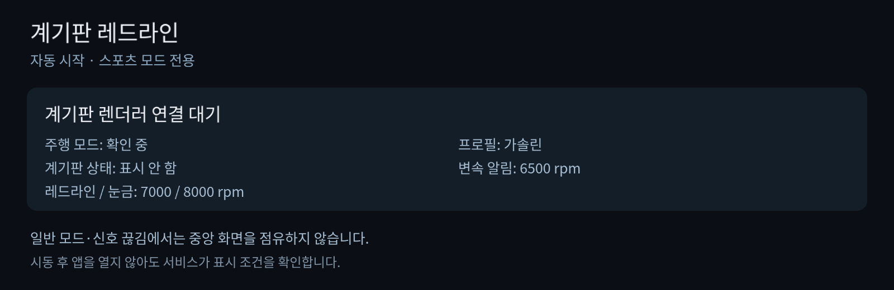

# 계기판 레드라인

[English](README.md) | 한국어

MGU / iDrive 7의 **계기판 중앙 지도 영역**에 큰 RPM·회전수 바·변속 알림을 표시합니다.
앱 ID는 `cluster_redline`, 버전은 **0.2.1**입니다. 회로 퍼즐과 별도 앱입니다.
**실차 검증 전 시험판**이며, PC 미리보기·신호 처리·설정·프로토콜 검사를 진행했습니다.




## 표시 조건

| 상황 | 동작 |
|---|---|
| MGU 시작 | 앱만 백그라운드에서 자동 시작, 계기판 표시 OFF |
| 컴포트·에코·어댑티브 | 표시 OFF, 계기판 슬롯을 예약하지 않음 |
| 스포츠·스포츠 플러스·스포츠 개별 설정 | 모드 1초 확인과 최신 RPM을 만족하면 표시 요청 |
| 설정한 회전수 도달 | 변속 표시등 전체 점등과 **변속 시점** 안내 |
| 스포츠 해제·엔진 정지·신호 끊김 | 계기판 레이어 해제 |
| 설정의 자동 표시 OFF | 스포츠 모드에서도 표시하지 않음 |

앱을 계속 열어둘 필요가 없으며, 부팅 때 설정 화면을 자동으로 열지 않습니다.
`스포츠 모드 자동 표시` 설정은 기본 ON이고 **화면의 기본 상태가 OFF**입니다.
기어레버 D/S가 아니라 차량의 SPORT 주행 모드를 기준으로 합니다.

## 한국어 설정

설정 화면, 엔진 프로필, 주행 모드와 계기판 상태를 한글로 표시합니다.
앱의 한글을 표시하려면 **한국어 폰트를 포함하는 `ko` 빌드**가 필요합니다.
이 저장소의 `build-apps.py`는 두 앱 모두 한국어로 빌드합니다.
원본 `preview.js`는 이미 빌드한 결과를 읽으므로, 실행 시 언어만 바꿔도 재번역되지는 않습니다.

- 스포츠 모드 자동 표시: 기본 ON
- 엔진 프로필: **가솔린 / 디젤 / 하이브리드**, 기본 가솔린
- 변속 알림 회전수·레드라인 회전수·회전수 눈금 최댓값: 기본 **프로필 기본값**
- 계기판 갱신 속도: 기본 8 fps, 최대 12 fps
- 렌더러: 소프트웨어

| 엔진 프로필 | 변속 알림 | 레드라인 | 눈금 최대 |
|---|---:|---:|---:|
| 가솔린 | 6500 rpm | 7000 rpm | 8000 rpm |
| 디젤 | 4200 rpm | 5000 rpm | 6000 rpm |
| 하이브리드 | 6500 rpm | 7000 rpm | 8000 rpm |

이는 차량별로 검증된 엔진 한계나 최적 변속 시점이 아닌 **표시용 초기값**입니다.
차량에 맞게 조절하세요. 사용자님의 2019 G20 330i는 가솔린을 선택합니다.
설정의 내부 값 0은 회전수 0이 아니라 프로필 기본값을 뜻합니다.
프로필을 변경하면 세 회전수 설정을 초기화하고 최신 신호를 다시 확인합니다.
0.1.x 가솔린 버전의 수동값은 업그레이드만으로 초기화하지 않습니다.

하이브리드는 330e·530e 같은 가솔린 기반 PHEV의 엔진 RPM용입니다.
엔진이 정지하면 숨기고 재시동 후 최신 RPM이 들어오면 다시 표시합니다.
RPM 0만으로 전기 구동·주차·회생을 구분하지 않습니다.
전기 출력·회생 kW·배터리 SOC·순수 전기차 화면은 포함하지 않습니다.
엔진 종류는 자동 감지하지 않고 직접 선택합니다.

## 필요한 환경

- MGU / iDrive 7, `cluster-render 0.3.10+`, ID7 `map:1088x480` 대상
- 자동 시작을 지원하는 `mgu-deploy 0.7.17+`
- 한국어 지원과 한글 폰트가 적용된 원본 `idrive7-apps`
- 설치용 빌드에는 자신의 차량에서 추출한 `oap-sdk`
- 차량 카탈로그의 읽기용 getter: `CDS.statusEngineSpeed2`, `FES.statusFESVehicleDynamicSwitchHMI`

## PC 미리보기

기존 프로젝트와 이 저장소를 나란히 놓고, **이 저장소 최상위 폴더**에서 실행합니다.

```powershell
python tools/build-apps.py --project "../idrive7-apps" --apps cluster_redline --preview-only
node tools/cluster-redline-preview.js
```

`preview/cluster_redline/index.html`을 열면 가솔린·디젤·하이브리드의 실제 앱 코드로 그린
한글 화면을 확인할 수 있습니다. 숫자는 데모이며 차량 소켓에 연결하지 않습니다.
설정 앱 화면은 원본의 미리보기 도구로 확인할 수 있습니다.

```powershell
node ../idrive7-apps/kit/tools/preview.js dist/cluster_redline preview/cluster_redline-ui frames=3
```

PC에는 실제 차량 신호가 없으므로 설정 화면은 연결 대기로 나오는 것이 정상입니다.

## 빌드와 설치

```powershell
python tools/build-apps.py --project "../idrive7-apps" --apps cluster_redline
```

결과는 `dist/cluster_redline-ko-kit.zip`입니다. 압축 안의 `INSTALL.ko.md`를 따르세요.
먼저 MGU에서 `sh install-on-mgu.sh check`, 통과 후 root로 `sh install-on-mgu.sh install`을 실행합니다.
`--apps cluster_redline`을 생략하면 두 앱을 한 키트에 넣습니다.

소스를 원본 프로젝트에 복사하려면:

```powershell
python tools/install-overlay.py ../idrive7-apps --apps cluster_redline
```

복사 후 원본 폴더에서 `python tools/build-apps.py --project . --apps cluster_redline`을 사용하세요.
원본 `kit/tools/build.py`만 사용하면 자동 시작 메타데이터가 빠집니다.

## 신호와 화면 우선순위

RPM은 `actualValueRPMEngineCrankshaft × 0.25`, 모드는 `actualValueModeDrivingExperience`를 읽습니다.
스포츠 값 1·2·3과 대응하는 이름을 확인합니다. RPM은 1.8초, 모드는 3.5초 넘게 오래되면 숨깁니다.
엔진 100 rpm 미만, 유효하지 않은 값, 렌더러 연결 끊김에서도 숨깁니다.
차량 신호에는 쓰기 API를 사용하지 않으며 엔진·변속기·코딩을 제어하지 않습니다.

중앙 `map` 영역만 사용하고 전체 계기판 `panel`이나 HUD로 출력하지 않습니다.
낮은 콘텐츠 우선순위와 비독점 레이어, `guide_hold=0`을 요청합니다.
`contend=1` 때문에 스포츠 모드에서는 중앙 순정 지도가 이 위젯으로 교체될 수 있습니다.
순정 경고·길안내 우선순위, 화면 복귀, 자동 시작과 절전 진입은 실차 검증이 필요합니다.

## 검사

저장소 최상위에서 `tests/cluster_redline/`의 Node 검사를 실행합니다.
렌더링·설정 검사는 먼저 이 앱의 미리보기 빌드를 하세요.
설정 검사는 `node tests/cluster_redline/profile-settings.test.js ../idrive7-apps`입니다.
계기판 클라이언트는 원본을 수정하지 않았으며 MPL-2.0 라이선스와 출처를 저장소에 포함했습니다.
