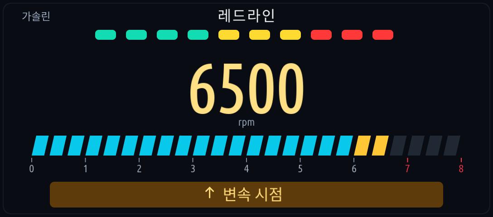

# 계기판 레드라인

[English](README.md) | 한국어

기존 `idrive7-apps`에 함께 넣어 빌드·설치하는 앱입니다. ID는 `cluster_redline`, 버전은 **0.3.0**입니다.
**실차 검증 전 시험판**이며 차량 값은 읽기만 합니다.



## 동작과 엔진 프로필

MGU 시작 시 앱만 백그라운드에서 자동 시작합니다. 계기판 기본 표시는 OFF이며,
스포츠·스포츠 플러스·스포츠 개별 설정과 최신 RPM을 확인하면 중앙 지도 영역에 표시를 요청합니다.
일반 모드·신호 끊김·엔진 정지에서는 레이어를 해제합니다.
앱 화면을 계속 열어둘 필요가 없으며 설정에서 자동 표시를 끌 수 있습니다.

| 엔진 프로필 | 변속 알림 | 레드라인 | 눈금 최대 |
|---|---:|---:|---:|
| 가솔린 | 6500 rpm | 7000 rpm | 8000 rpm |
| 디젤 | 4200 rpm | 5000 rpm | 6000 rpm |
| 하이브리드 | 6500 rpm | 7000 rpm | 8000 rpm |

차량별로 검증된 한계나 최적 변속 시점이 아닌 **표시용 초기값**입니다. 본인 차량에 맞게 조절하세요.
2019 G20 330i는 가솔린을 선택합니다. 엔진 종류는 자동 감지하지 않습니다.
프로필을 바꾸면 수동 RPM 설정을 초기화하고 최신 신호를 다시 확인합니다.
하이브리드는 가솔린 기반 PHEV의 엔진 RPM용이며, 엔진 정지 시 숨깁니다.
전기 출력·회생·SOC·순수 전기차 화면은 포함하지 않습니다.

## 기존 명령으로 언어 선택·미리보기

추가 소스만 받았다면 먼저 [소스 합치기](../../docs/JAM-INTEGRATION.ko.md)를 한 번 진행하세요.
이후 **합쳐진 원본 프로젝트 최상위 폴더**에서:

```powershell
python kit/tools/build.py --language ko --preview-only cluster_redline
node kit/tools/preview.js dist/cluster_redline preview/cluster_redline-ui frames=3
node tools/cluster-redline-preview.js
```

기본은 영어이며 `--language ko`를 넣으면 한국어로 빌드합니다.
계기판 데모는 `preview/cluster_redline/index.html`, 앱 상태 화면은 `preview/cluster_redline-ui/`에서 확인합니다.
미리보기 실행 시 언어만 바꾸는 것이 아니라 **빌드할 때 언어를 선택**해야 합니다.

## 기존 앱들과 한 번에 배포

```powershell
python kit/tools/make_kit.py --language ko
```

앱 이름을 생략하면 기존 앱 전부와 새 두 앱을 한 번에 빌드합니다.
기존 `deploy\make-car-kit.cmd --language ko` 또는 `deploy/make-car-kit.sh --language ko`도 같습니다.
완성 파일은 **`dist/mgu-custom-apps-ko.tar.gz`**이며 기존 `push-to-car`로 검사·설치합니다.
[공통 설치 안내](../../docs/JAM-INTEGRATION.ko.md)를 따르세요.

별도 `mgu-deploy`는 필요하지 않습니다. 소스 합치기 도구가 기존 빌드·설치 도구의
앱별 시작 정보 처리를 보완하므로 이 앱만 자동 시작하고 Circuit과 기존 앱은 수동 실행합니다.
`cluster-render 0.3.10+`가 없거나 낮으면 기존 배포 검사에서 이 앱을 거부합니다.
다른 앱은 원본 배포 도구의 기존 처리 방식에 따라 설치할 수 있습니다.

## 신호와 화면 우선순위

RPM은 `actualValueRPMEngineCrankshaft × 0.25`, 모드는 `actualValueModeDrivingExperience`를 읽습니다.
스포츠 값 1·2·3과 대응하는 이름을 확인합니다. RPM은 1.8초, 모드는 3.5초 넘게 오래되면 숨깁니다.
엔진 100 rpm 미만, 유효하지 않은 값, 렌더러 연결 끊김에서도 숨깁니다.
차량 신호에는 쓰기 API를 사용하지 않으며 엔진·변속기·코딩을 제어하지 않습니다.

중앙 `map` 영역만 사용하고 전체 계기판 `panel`이나 HUD로 출력하지 않습니다.
낮은 콘텐츠 우선순위와 비독점 레이어, `guide_hold=0`을 요청합니다.
`contend=1` 때문에 스포츠 모드에서는 중앙 순정 지도가 이 위젯으로 교체될 수 있습니다.
순정 경고·길안내 우선순위, 화면 복귀, 자동 시작과 절전 진입은 실차 검증이 필요합니다.

## 검사

저장소 최상위에서 `tests/cluster_redline/`의 Node 검사를 실행합니다.
렌더링·설정 검사는 먼저 이 앱의 미리보기 빌드를 하세요.
설정 검사는 `node tests/cluster_redline/profile-settings.test.js ../idrive7-apps`입니다.
계기판 클라이언트는 원본을 수정하지 않았으며 MPL-2.0 라이선스와 출처를 저장소에 포함했습니다.
