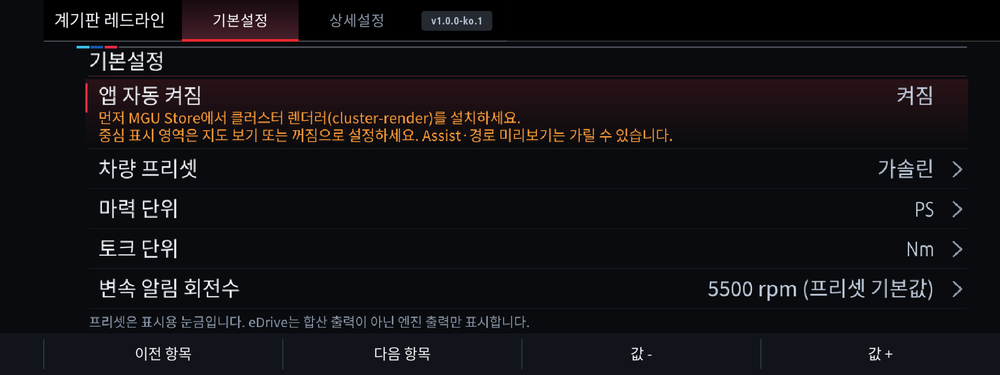
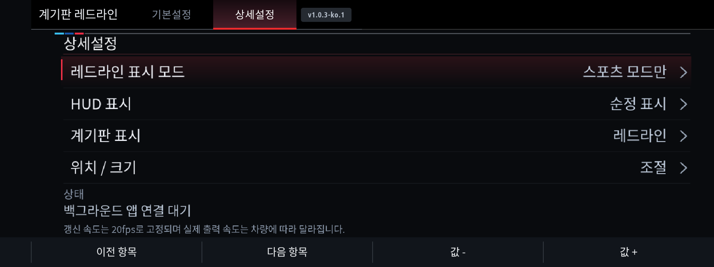

# 계기판 레드라인

English: [README.md](README.md)

MGU에서 백그라운드로 동작하는 계기판 RPM·변속 알림 앱입니다.
**0.8.3**은 앱 제목 옆 기본설정 / 상세설정 탭을 제공합니다.




**순정 지도 교체 방식:** 상세설정에서 표시 레이어를 **지도 영역**으로 선택하고,
계기판 → 중심 표시 영역은 **지도 보기 또는 꺼짐**으로 설정합니다.
전면 중앙 모드는 기존 꺼짐 안내를 유지합니다. 현재 표시 레이어에 맞는 안내가
앱 자동 켜짐 아래 주황색으로 표시됩니다.
첫 줄에는 MGU Store에서 클러스터 렌더러(cluster-render)를 먼저 설치하라는 안내를 표시합니다. 앱이 순정 메뉴를 자동으로 바꾸지는 않습니다.

기본설정: 앱 자동 켜짐, 차량 프리셋(가솔린 / 디젤 / eDrive / M), 표시 모드(스포츠 모드만 / 전체 모드), 마력 단위(PS / kW), 토크 단위(Nm / kgf·m).

상세설정: 변속 알림 RPM, 표시 레이어(전면 중앙 / 지도 영역), 전체 크기(60~100% 단계 선택).
기어 앞 문자는 차량 신호로 결정하고 RPM·토크·마력 눈금은 프리셋을 사용합니다.
프리셋은 차종별 제원을 자동 조회한 값이 아닌 표시용 분류입니다.

기본은 가솔린, 스포츠 모드만, 20fps 고정, 크기 80%, PS / Nm입니다.
가솔린 RPM 눈금은 7000, 적색 시작은 6000, 기본 변속 알림은 6500입니다.
알림에 도달하면 RPM 숫자가 빨간색으로 바뀝니다. 엔진 꺼짐·오래된 신호·연결 끊김에서는 숨깁니다.
자동 켜짐 OFF는 출력과 신호 구독을 종료하지만 설정을 켤 수 있는 MainApp 호스트는 유지합니다.

마력*은 ECU 토크와 RPM으로 계산한 추정 출력입니다. eDrive는 엔진 출력만 표시하고 모터·시스템 합산 출력을 표시하지 않습니다.
단위를 바꾸면 값·최고 기록·눈금을 함께 환산합니다.
D/S/M은 실제 선택기·변속 프로그램 신호를 사용하며 차체 스포츠 모드만으로 S를 추측하지 않습니다.

## 설치와 빌드

MGU Store에서 이 저장소를 추가하고 한국어 또는 영어 항목을 설치합니다.
필요한 cluster-render가 없거나 구버전이면 Store가 먼저 설치/업데이트하고 앱을 설치합니다.
렌더러는 기본 Robertn 소스에서 가져옵니다. [자동 선행 설치 안내](../../docs/AUTO-RENDERER.ko.md)를 참고하세요.
기존 upstream 폴더에서는 소스 오버레이를 적용한 뒤 일반 빌드·설치 방식을 사용합니다.

```powershell
python tools/install-overlay.py C:\BMW\idrive7-apps-main --apps cluster_redline --force
cd C:\BMW\idrive7-apps-main
python kit/tools/build.py --language ko cluster_redline
```

추출한 oap-sdk와 cluster-render >= 0.3.10이 필요합니다. SDK는 이 저장소에 포함하지 않습니다.
자동 시작은 MainApp이 관리합니다. 엔진·변속기·코딩 제어 API는 사용하지 않습니다.

[0.8.3 설치 안내·20fps 고정](../../docs/CLUSTER-REDLINE-0.8.3.ko.md)

[지도 교체·첫 프레임 전송 순서](../../docs/CLUSTER-REDLINE-0.8.2.ko.md)

[지도/Assist 전면 표시 조사](../../docs/CLUSTER-OVERLAY-RESEARCH.ko.md)

지도 영역은 순정 지도와 경쟁할 수 있습니다. 전면 중앙도 모든 순정 화면보다 위에 표시되는 것이 실차 검증되지는 않았습니다.
실제 20fps 지속 출력과 S/M 신호 수신 여부는 차량·펌웨어에 따라 확인해야 합니다.

0.8.2부터 첫 픽셀 프레임을 소켓에 쓴 뒤 표시를 켭니다. 초기 슬롯 선점 경쟁의 해결은 실차 검증 전입니다.
