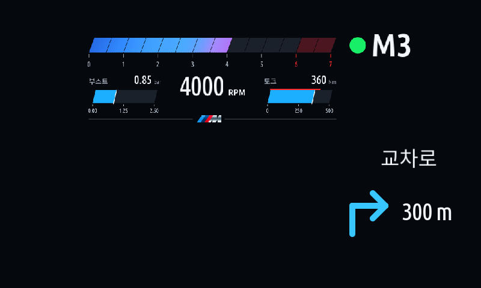
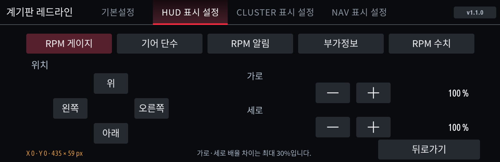

# Cluster Redline 1.1.0

[한국어](README.ko.md) · [Current guide](../../docs/CLUSTER-REDLINE.ko.md) · [Changelog](../../CHANGELOG.md)

RPM, gear and shift alerts for the iDrive 7 cluster/HUD, with received maneuver guidance composed alongside HUD RPM. Requires **cluster-render 0.4.0+**.

Four settings tabs separate Basic, HUD, CLUSTER and NAV. Auto-start controls the next launch; Start app / Stop app controls the live worker while keeping settings available.

HUD and CLUSTER each store Sport/All output choices, auxiliary information, top-bar/filled-circle alert design and independent component placement. Choose Boost, Torque, Power*, G-force, Outside temperature or Oil temperature: one or two gauges, or one to four text metrics. Ordered selection is committed only by OK. Defaults are Boost/Torque gauges. Missing/stale measurements show `--`; Power* estimates engine output from torque/RPM, excluding combined electric output.

The filled circle is 70% of gear glyph height and preserves the existing green/yellow/flashing-red thresholds. Per-element width/height ratios are limited to 1.3. Placement shows X/Y offsets and actual output-region width × height in pixels.

NAV offers All / Except Sport, gray/white/blue arrows and separate uniform scaling/position for direction and text. Received maneuver descriptions appear above the arrow, defaulting just beyond the RPM bar on the right. Existing installs move once, then retain user adjustments. Six highway entry/exit variants include a diagram, label and received distance. This does not add map images or lane-picture decoding. Unsupported/stale guidance yields to stock navigation.

Refresh MGU Store source `jaimeen77-cmyk/apps`, branch `main`, and select Korean or English. For desktop integration use [the overlay guide](../../docs/JAM-INTEGRATION.ko.md) with your own SDK. Never publish SDK-containing artifacts. Set the cluster central display to Map view or Off. Assist coverage/recovery and this release's final coordinates still need vehicle verification.
