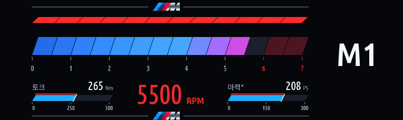
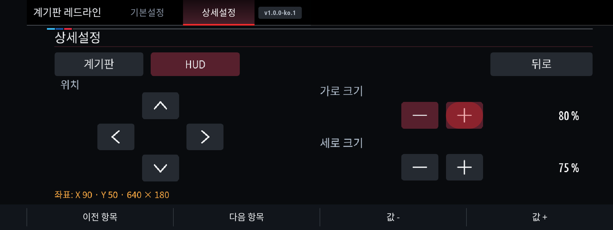
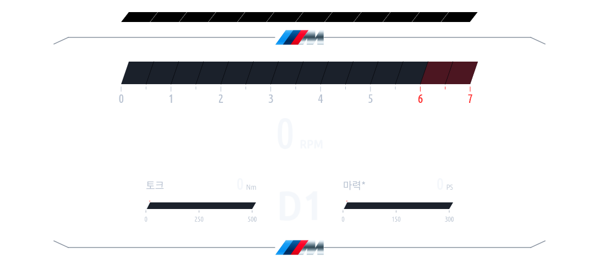
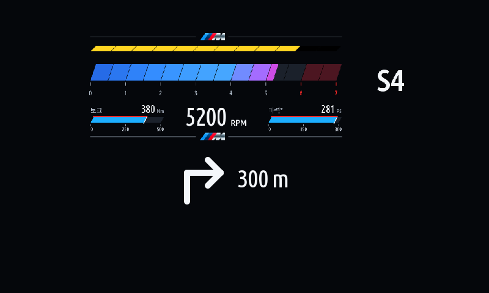
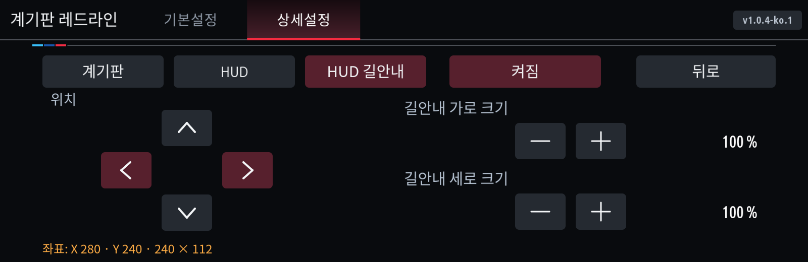

# Cluster Redline 1.0.5
## 1.0.1
1.0.5 fixes guidance polling starvation on repeated state notifications and prevents older reads overwriting newer turns. [Fix notes](../../docs/CLUSTER-REDLINE-1.0.5.ko.md).


1.0.4 restores the earlier 800×240 HUD layout and side-gauge sizes with correctly sized metallic M marks. Both displays share blue/lighter-blue RPM cells, changing to purple/pink after4000rpm and red at the configured redline. [Changes](../../docs/CLUSTER-REDLINE-1.0.4.ko.md).

Read-only Guidance maneuver/provider/state inputs compose a turn arrow and supplied distance into our HUD. Missing/stale maneuver data preserves stock guidance. Stop & Go zero-RPM retention and bounded transient recovery remain.


[한국어](README.ko.md)

RPM, gear and shift lights for the iDrive 7 cluster and HUD. The full-screen settings UI keeps two tabs and large touch/rotary controls.

## Settings

Basic settings: App auto start, vehicle preset, power unit, torque unit, shift alert RPM. The preset threshold is now 5500 rpm for Petrol, eDrive and M; Diesel remains 4200 rpm. Saved explicit thresholds are retained. Presets set display scales, not discovered vehicle specifications. Petrol keeps a 7000 rpm scale and a red zone from 6000.

Advanced settings: Redline display mode (Sport / All drive modes), HUD display (Redline / Stock), Cluster display (Redline / Stock), Position / size. Each display mode remembers its own output choices. Both outputs may run together using the map and HUD targets; selecting Stock releases that output. Panel is no longer selected: panel and HUD share a native scene ID.

Position / size lets you select Cluster or HUD, move in 10-pixel steps and adjust width/height separately in 5% steps. Temporary X/Y/width/height readouts show the bounded native placement. Changes update the existing layer without repeatedly reacquiring it.

HUD restores the earlier top RPM bar, large central RPM, side torque/power gauges and received gear at the right. Cluster/HUD share the RPM palette and metallic M. Gear prefixes follow received signals.

Defaults: Sport only; Cluster Redline, HUD Stock; Petrol; PS/Nm; fixed 20 fps request ceiling. Cluster dimensions default to 80% and HUD to 75%. Actual rendering speed depends on the car. eDrive power is engine-only, estimated from engine torque and RPM, not combined electric output.

## Factory HUD navigation

**Requires cluster-render0.4.0+.** HUD contention is permitted only while fresh supported maneuver data is already composed. Otherwise stock guidance takes priority. Native popup/foreign-owner yielding and linger policies still apply.

**Advanced settings > Position / size > HUD navigation** has its own On/Off, position, width and height. CarPlay/Android Auto schema definitions are used; actual phone-app delivery and vehicle rendering remain unverified. Unsupported guidance preserves the stock HUD.

The app checks that the native HUD policy leaves stock takeover disabled and includes popup yield slot `0x322`. An unsafe owner override suppresses only this app's HUD output and reports a settings warning. It never enables `hud_take_over_stock`, changes BMW menus, bypasses native guards or resets renderer configuration.

Cluster output continues using the map target and supported maneuver-panel guide hold. Set Instrument cluster > Central display area to Map view or Off. Assisted Driving View and route preview coverage still need car validation. No guarantee of immediate takeover is made.

## Install

In MGU Store add source `jaimeen77-cmyk/apps`, branch `main`, check for updates and choose Korean or English. Store resolves cluster-render >= 0.4.0 before Redline when a registered renderer source offers it. Desktop car kits require that renderer separately.

For desktop builds, merge this source overlay into a complete upstream checkout with your own extracted SDK:

```sh
python tools/install-overlay.py /path/to/idrive7-apps --apps cluster_redline --force
cd /path/to/idrive7-apps
python kit/tools/build.py cluster_redline
python kit/tools/build.py --language ko cluster_redline
```

Use the normal kit/install workflow. Do not publish generated SDK-containing packages. No engine, gearbox, coding or navigation-control APIs are added. Stale data, app-off and renderer loss release output. Fresh zero RPM after engine operation retains the face during automatic stops. Existing auto-start OFF, custom thresholds and output choices are migrated.

## Validation

Host tests cover settings entry/touch/rotary routing, independent outputs, shared upload pacing, live placement, exact image deltas, lifecycle cleanup and compatibility. The real upstream 0.4.0 SlotManager host suite passes 268 checks, including newly parked HUD guidance yielding and recovery. These use simulated hardware ports; vehicle rendering, HUD coordinates and stock guidance return remain unverified on the car. Unix-socket and Node subprocess archive integration are restricted in the current build sandbox.

[Detailed Korean change/validation notes](../../docs/CLUSTER-REDLINE-1.0.0.ko.md) · [Renderer dependency guide](../../docs/AUTO-RENDERER.ko.md)





[1.0.2 install fix: request the native Guidance Main_Instance explicitly and omit this optional proxy when its instance/getter is unavailable. Vehicle installation still needs confirmation.](../../docs/CLUSTER-REDLINE-1.0.2.ko.md)





