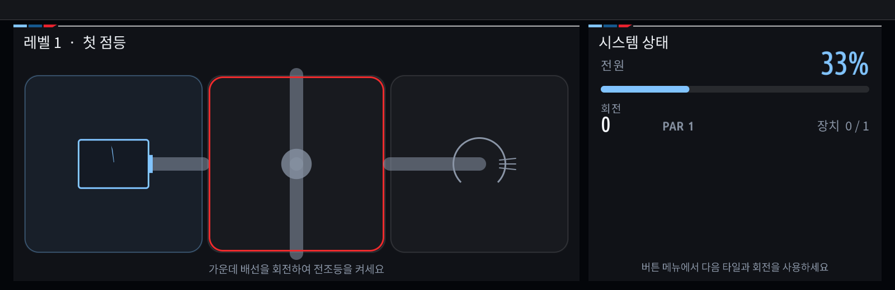

# 아이드라이브 회로

[English](README.md) | 한국어

BMW MGU / iDrive 7용 주차 전용 회로 퍼즐입니다. 타일을 회전해 모든 모듈에 전력을 연결하세요. 회로와 전력은 게임 속 시뮬레이션입니다.



## 기능과 조작

- 튜토리얼 포함 30개 레벨, 되돌리기·힌트·다시 시작, 최소 회전수·별 평가, 진행 저장
- GPU: 노브 회전으로 선택, 방향 밀기로 이동, 누르거나 터치해서 회전
- 소프트웨어: 버튼 메뉴의 **다음 타일**, **회전** 사용
- 기본 **주차 중에만 실행** 설정에서 3 km/h를 넘으면 퍼즐 입력 잠금

차량 속도 신호만 읽으며 제어 값을 쓰지 않습니다. 운전 중 퍼즐을 조작하지 마세요.

## 기존 idrive7-apps에서 미리보기

추가 소스만 받은 경우 먼저 [소스 합치기](../../docs/JAM-INTEGRATION.ko.md)를 한 번 진행하세요.
이후 **합쳐진 원본 프로젝트 최상위 폴더**에서 실행합니다.

```powershell
node kit/tools/test_idrive_circuit.js
python kit/tools/build.py --language ko --preview-only idrive_circuit
node kit/tools/preview.js dist/idrive_circuit preview/idrive_circuit frames=3
```

기본 언어는 영어입니다. `--language ko`를 생략하고 다시 빌드하면 영어로 표시합니다.

## 기존 방식으로 키트 만들기

```powershell
python kit/tools/make_kit.py --language ko idrive_circuit
```

명령 끝의 앱 이름을 생략하면 기존 앱과 새 앱을 전부 함께 빌드합니다.
완성 파일은 `dist/mgu-custom-apps-ko.tar.gz`이며 기존 `push-to-car`로 검사·설치합니다.
[설치 상세 안내](../../docs/JAM-INTEGRATION.ko.md)를 따르세요.

이 앱은 계속 **수동 실행**합니다. 함께 배포해도 자동 시작하거나 계기판에 표시하지 않습니다.
Circuit만 사용할 때는 cluster-render가 필요하지 않습니다. 소스는 기존 MIT 라이선스를 유지합니다.
