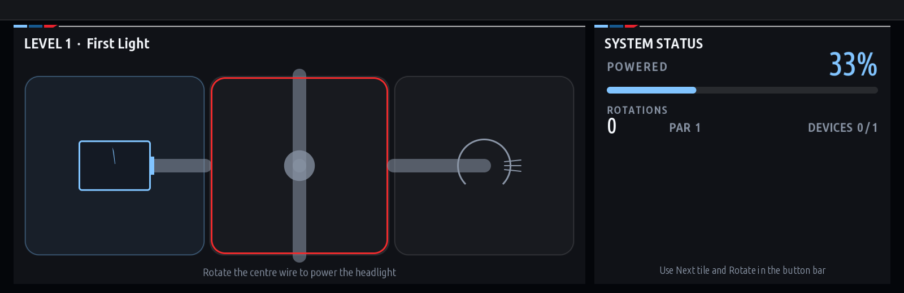

# iDrive Circuit

English | [한국어](README.ko.md)

A parked-only circuit puzzle for BMW MGU / iDrive 7. Rotate wiring tiles until battery power reaches every simulated module. Includes 30 levels, touch/controller input, Undo, Hint, Restart, PAR scores, stars and saved progress.

[Install from MGU Store](../../docs/INSTALL.md) · [Screenshot gallery](../../screenshots/README.md)



GPU controls: turn to select, tilt to move to a neighbour, press/touch to rotate. The software path provides Next tile and Rotate buttons. With Parked only enabled (default), actions lock above 3 km/h. No vehicle-control writes are sent.

## Normal upstream workflow

First merge the app sources into upstream with `python tools/install-overlay.py ../idrive7-apps` if this is an overlay-only checkout. The following commands run **inside the complete upstream project**:

```powershell
node kit/tools/test_idrive_circuit.js
python kit/tools/build.py --language ko --preview-only idrive_circuit
node kit/tools/preview.js dist/idrive_circuit preview/idrive_circuit frames=3
```

English is the default: omit `--language ko`. Both languages use the same app ID.

```powershell
python kit/tools/make_kit.py --language ko idrive_circuit
```

Omit the app name to include every app in the project. Output is the normal `dist/mgu-custom-apps-ko.tar.gz`; install with the existing `push-to-car` check/install workflow. See [integration guide](../../docs/JAM-INTEGRATION.ko.md).

Circuit remains **manually started**, even when bundled with an autostart app. Its source remains MIT licensed. `puzzle.js` holds the pure game rules, `levels.js` the boards, `main.js` the HMI integration and `icon.png` the tile artwork.
