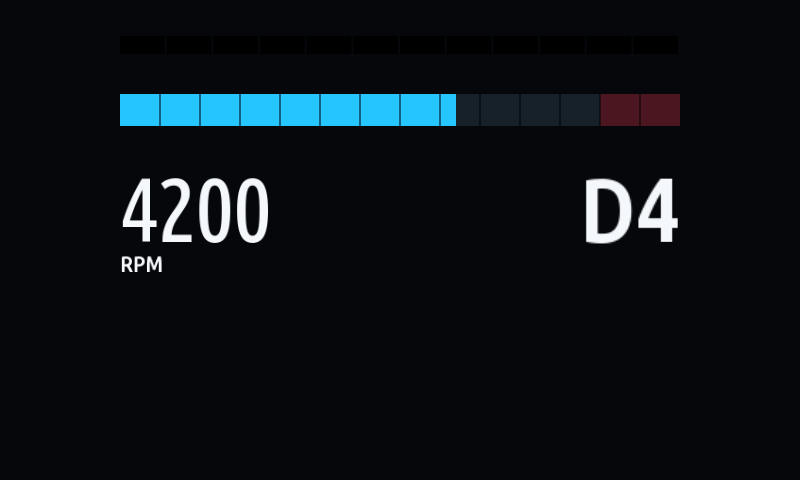
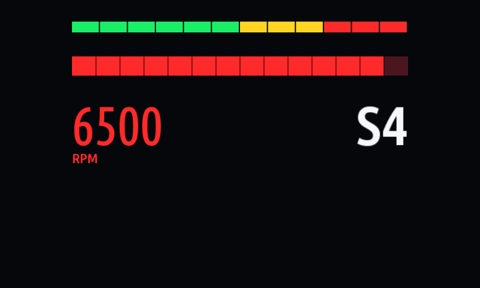
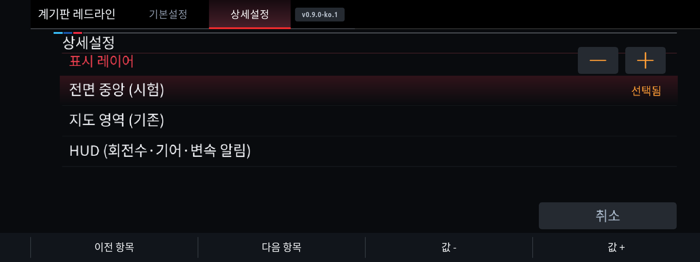

# 계기판 레드라인 0.9.0: HUD 출력

## 켜는 방법

1. MGU Store의 `jaimeen77-cmyk/apps` 소스에서 main → Check now를 누르고 사용할 언어판을 업데이트합니다.
2. 앱 상단 버전이 `v0.9.0`인지 확인합니다. PC 한국어 빌드는 `v0.9.0-ko.1`입니다.
3. **상세설정 → 표시 레이어 → HUD (회전수·기어·변속 알림)**을 선택합니다.
4. **기본설정 → 앱 자동 켜짐**을 켜고, 기본 표시 모드라면 스포츠 모드에서 확인합니다.

HUD에는 RPM 바·숫자, 기어(D/S/M 및 단수), 변속 알림 등이 표시됩니다.
기어는 차량에서 실제 수신한 값만 사용합니다. 변속 알림 회전수는 계기판 출력과 같은 설정이며,
그 회전수에 도달하면 RPM 숫자와 바가 빨간색으로 바뀝니다. 켜지지 않은 알림 칸은 검은색입니다.
마력·토크 게이지는 계기판 출력에 유지하며 HUD에는 넣지 않았습니다.

**HUD를 선택하면 계기판 레드라인 출력은 중지됩니다.** 계기판으로 돌아오려면 표시 레이어에서
전면 중앙 또는 지도 영역을 선택하세요. 기본값과 기존 저장 설정은 그대로 유지됩니다.
위젯 크기와 스포츠/전체 모드 선택은 HUD에도 적용됩니다. 설정 글자와 터치 영역은 0.8.7의 큰 크기를 유지합니다.

## 렌더러 제약

`cluster-render`가 필요합니다. Store의 기존 선행 설치 처리는 유지됩니다.
업스트림 렌더러의 iDrive 7 `hud:800x480` 대상을 사용하며, 해당 대상이 없거나 크기가 다르면
출력을 요청하지 않습니다. iDrive 8 출력으로 바꾸거나 임의의 화면 번호를 사용하지 않습니다.

업스트림 기본 구성에서 HUD와 전면 중앙(panel)은 같은 scene ID를 사용하므로 이 앱은
두 대상을 동시에 요청하지 않습니다. 다른 앱이 panel을 사용 중이면 먼저 그 앱의 출력을 꺼야 할 수 있습니다.
계기판/HUD 동시 출력은 이번 버전에 포함하지 않습니다.

HUD 요청은 `contend:false`, `guide_hold:false`이며 **순정 HUD 안내의 강제 해제/선점 설정을 변경하지 않습니다.**
순정 안내가 우선하면 레드라인 HUD가 보이지 않을 수 있습니다. 계기판 중심 표시 영역 메뉴를
HUD 사용을 위해 변경할 필요는 없습니다. HUD 그림의 하단은 투명하게 비워두지만 실제 위치·크기·가림 여부는
차량 HUD와 펌웨어에 따라 확인해야 합니다.

## 검사와 실차 확인

호스트 검사는 HUD 대상/크기 확인, 계기판과 HUD 전환 시 이전 레이어 해제, 최초 프레임 이후 표시,
스포츠 모드·회전수 신호 유효성, OFF/엔진 정지 시 해제, 변속 회전수와 기어 전달,
투명 배경·적색 알림·차분 프레임 복원, 한국어/영어 설정을 확인합니다.
이 결과가 사용자의 2019 G20 HUD 실차 동작을 확인한 것은 아닙니다.

미리보기:

```powershell
node tools/cluster-redline-preview.js dist/cluster_redline preview/cluster_redline
```

생성되는 `hud-rpm-on-black.png`, `hud-shift-on-black.png`는 앱의 실제 그리기 코드로 만든 데모입니다.
차량 앞유리 사진이나 순정 HUD와 합성한 실측 결과는 아닙니다.

실차에서는 우선 정차 상태에서 HUD 대상이 선택되는지와 정상 복귀를 확인하세요.
순정 속도·경고·내비 안내와의 배치는 별도 확인이 필요합니다. 실제 출력 속도를 측정하지 않았으며
20fps는 앱의 요청 상한입니다. 차량 설정 쓰기나 엔진·변속기 제어는 추가하지 않았습니다.

English: choose **Advanced settings → Display layer → HUD (RPM / gear / shift)**.
HUD replaces this app's cluster output; it is not simultaneous panel/HUD rendering.
The existing Sport/all-mode and shift-RPM settings apply. Unsupported HUD geometry disables output;
factory HUD guidance is not forcibly displaced. Real-vehicle HUD validation is still required.

검사 기록: 한국어·영어 설치 패키지 빌드, HUD/설정 화면/실제 입력 라우팅/설정 저장 검사,
10개 정책·기어·신호·렌더러 단위 검사, Store 의존성 큐, 소스 오버레이,
notifier-only 회귀 검사와 네 언어별 공개 템플릿의 체크섬·스키마 검사를 통과했습니다.
이 환경은 Unix 소켓 listen과 Node의 tar 자식 실행을 제한하므로
실제 소켓 프로토콜 검사와 Store 전체 설치 검사는 이번 실행에서 완료하지 못했습니다.
차량에 연결하거나 실제 HUD 프레임을 확인하지는 않았습니다.






