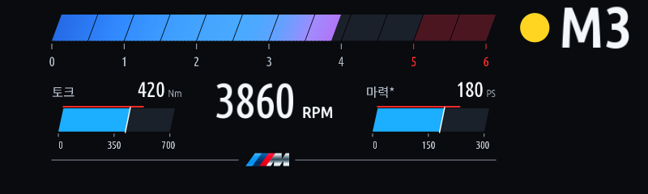
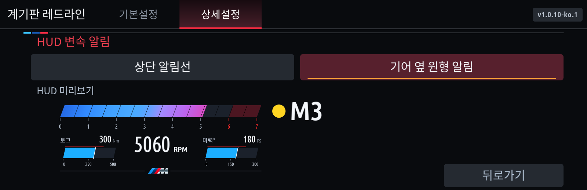

# 계기판 레드라인 1.0.10

HUD 화면 배치를 조정하고 변속 알림과 토크·마력 표시 방식을 선택할 수 있도록 했습니다.

- 상단 M은 삭제했습니다. 상단 알림선 또는 기어 왼쪽의 색이 채워진 원을 선택합니다.
- 원 지름은 기어 글자 높이의 70%입니다. 기어와 원을 상단 RPM 게이지 높이에 맞췄습니다.
- 기존 알림의 첫 초록 점등 전에는 원이 보이지 않습니다. 기존 초록·노랑·빨강 전환 기준을 유지하며 빨강은 기존 주기에 맞춰 켜지고 꺼집니다.
- RPM 막대는 기존 높이의 90%, 글자는 10% 확대했습니다. 토크·RPM·마력을 위로 당겼습니다.
- 토크·마력 보조 게이지는 가로·세로 각각 10% 줄였으며, 아래 M선은 눈금과 겹치지 않게 위로 올렸습니다.
- 토크·마력은 게이지 / 숫자만 / 꺼짐 중에서 선택합니다. 숫자만은 토크 · RPM · 마력 순서로 숫자 크기를 맞춥니다.

설정 경로는 **상세설정 → HUD 표시 → HUD 화면 설정**입니다. 알림 방식과 보조 표시를 고르는 화면 아래에 RPM을 포함한 미리보기가 표시됩니다. 터치와 다이얼/하단 버튼으로 선택할 수 있고 뒤로가기는 오른쪽 아래에 있습니다. RPM이 변하지 않아도 설정을 바꾸면 HUD를 다시 그립니다.

## 길안내 수신

기존 공통 안내와 HUD view가 비어 있는 경우를 위해 선택적 `GuidanceEventList.queryContent` 읽기를 추가했습니다. Android Auto 실차 진단에서 문자열 enum 요청으로 회전 방향과 표시 거리를 읽는 데 성공했습니다. 숫자 enum 요청은 해당 바인딩에서 거절되어 앱에서는 성공한 문자열 방식만 사용합니다.

현재 휴대폰 안내의 활성 상태와 제공자가 일치할 때만 조회합니다. 한 번에 하나의 요청만 수행하고, 1초 조회 주기와 2초 유효기간을 적용합니다. 첫 이벤트가 해석되지 않을 때 뒤의 회전으로 건너뛰지 않습니다. 안내 종료·연결 해제·제공자 변경·앱 중지 뒤에는 이전 응답으로 화살표를 되살리지 않습니다.

새 요청 권한은 읽기 전용 queryContent뿐입니다. view 등록·설정, 안내 이벤트 쓰기, 차량 카탈로그 변경은 하지 않습니다. 해당 서비스/메서드를 지원하지 않는 차에서는 선택적 인터페이스를 제외합니다.

Android Auto 진단 성공은 **앱 UID 권한에서의 수신, CarPlay의 실제 데이터 제공, 레드라인과 안내의 실차 HUD 동시 표시**를 증명하지 않습니다. 이 항목들은 설치 후 확인이 필요합니다. 안내가 없거나 유효하지 않으면 순정 안내로 돌아갑니다. 지도나 교차로 확대 이미지를 합성하는 버전은 아닙니다.

## 검증 및 설치

한국어·영어 패키지를 빌드하고, 실제 HUD painter/차량용 UI 명령의 미리보기·선택·뒤로가기, 알림 색·채움·깜빡임 삭제, 게이지 축소 비율·M선 간격, 화면 변화량 복원, 일정 RPM에서의 설정 반영을 검사했습니다. 안내 수신부·worker의 모의 테스트와 Store/수동 설치의 query-only 호환성 필터도 검사했습니다. 모의 검증은 실차 표시 시험을 대신하지 않습니다.

MGU Store의 `jaimeen77-cmyk/apps` / `main` 소스를 갱신한 뒤 1.0.10을 설치합니다. 클러스터 렌더러가 필요합니다. HUD를 사용하려면 선택한 표시 모드의 HUD 출력을 레드라인으로 설정합니다. 기존 프리셋·RPM·표시 위치 설정은 유지됩니다.

공개 배포 파일은 SDK가 없는 runtime/UI 템플릿과 소스입니다. 차량 실행 파일·개인키·진단 로그·BMW SDK는 포함하지 않습니다.
