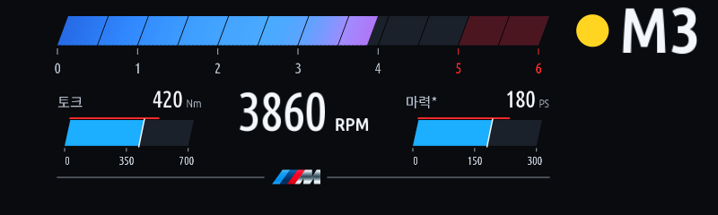
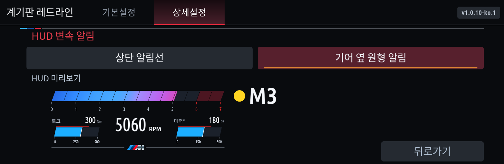

# 계기판 레드라인 사용 안내

현재 버전은 **1.0.10**입니다. 이전 버전의 변경 내용은 [업데이트 이력](https://github.com/jaimeen77-cmyk/apps/blob/main/CHANGELOG.md)에서 확인합니다.

## 설치와 실행

MGU Store에 `jaimeen77-cmyk/apps` / `main` 소스를 등록하고 새로고침한 뒤 한국어 또는 English판을 설치합니다. **클러스터 렌더러(cluster-render) 0.4.0 이상**이 필요합니다. 자세한 소스 등록 방법은 [스토어 안내](MGU-STORE.ko.md)를 참고하세요.

기본설정의 **앱 자동 켜짐**은 다음 앱 시작 시의 동작을 정합니다. **앱 켜기 / 앱 끄기**는 현재 표시 작업을 시작하거나 중지합니다. 끈 뒤에도 설정 화면에서 다시 켤 수 있습니다.

설치 오류는 [설치 실패 확인](REDLINE-INSTALL-FAILED.ko.md), 출력 문제의 상태·로그 수집은 [진단 안내](COLLECT-CLUSTER-REDLINE.ko.md)를 참고하세요. PC 빌드는 [소스 통합·설치 안내](JAM-INTEGRATION.ko.md)를 사용합니다.

## 기본설정과 표시 모드

- 차량 프리셋, 토크·마력 단위, 변속 알림 RPM을 선택합니다. 프리셋은 표시 눈금이며 차량 제원을 자동 인식한 값이 아닙니다.
- 기본 변속 알림은 가솔린·eDrive·M 5500rpm, 디젤 4200rpm입니다. 직접 저장한 RPM은 유지합니다.
- 스포츠는 스포츠 계열 모드에서 표시합니다. 모두는 컴포트·컴포트 플러스·에코 계열 등 차량의 유효한 주행 모드를 포함합니다.
- 상세설정에서 HUD와 계기판을 각각 레드라인 / 순정으로 고릅니다. 스포츠와 모두의 출력 선택을 따로 기억합니다.
- 계기판 중심 표시 영역은 지도 보기 또는 꺼짐으로 설정합니다. Assist/경로 미리보기의 가림과 복귀 동작은 차량에서 확인해야 합니다.

## HUD 화면 설정

**상세설정 → HUD 표시 → HUD 화면 설정**에서 알림 방식을 선택합니다. 선택 항목 아래에는 RPM이 포함된 미리보기가 표시됩니다.

- **상단 알림선:** RPM 막대 위의 변속 알림을 사용합니다.
- **기어 옆 원형 알림:** 기어 왼쪽에 색이 채워진 원을 표시합니다. 지름은 기어 글자 높이의 70%입니다. 점등 전에는 보이지 않으며, 초록·노랑으로 바뀌고 변속 알림 RPM에서 빨강으로 깜빡입니다.
- **토크·마력 표시:** 게이지 / 숫자만 / 꺼짐 중에서 고릅니다. 숫자만은 토크 · RPM · 마력 순서로 표시합니다.

기어와 원은 상단 RPM 게이지 옆에 맞추며, 아래 M선은 눈금과 겹치지 않게 배치합니다. 토크·마력은 엔진 입력에서 계산한 표시값이고 eDrive의 전기모터 합산 출력은 아닙니다.

**상세설정 → 위치 / 크기**에서는 계기판·HUD·HUD 길안내의 위치와 가로·세로 크기를 각각 조절합니다. 하위 화면의 뒤로가기는 오른쪽 아래에 있습니다.

## HUD 길안내

휴대폰 안내가 활성화되어 있고 유효한 방향·거리를 읽을 수 있을 때 RPM 화면과 안내를 한 이미지에 합성합니다. 읽을 수 없거나 오래된 안내는 표시하지 않고 순정 안내를 보존합니다. 안내 종료·연결 해제 뒤에 이전 화살표를 재사용하지 않습니다.

Android Auto 진단에서 회전 방향과 거리를 읽은 사실은 확인했습니다. **설치된 앱의 권한에서의 수신, CarPlay 실데이터, 레드라인과 안내의 실차 HUD 동시 표시**는 추가 확인이 필요합니다. 지도나 교차로 확대 이미지는 합성하지 않습니다.

## 검증과 배포 파일

한국어·영어 빌드와 화면·설정 조작·차분 갱신·안내 수명주기를 호스트에서 검사했습니다. 모의 검증은 실차 표시 시험을 대신하지 않습니다.

공개 저장소에는 SDK가 없는 템플릿과 소스만 제공합니다. 본인 SDK가 포함된 PC 설치 키트는 공개 공유하지 마세요.
