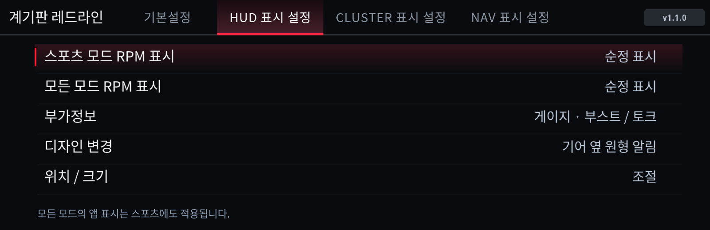
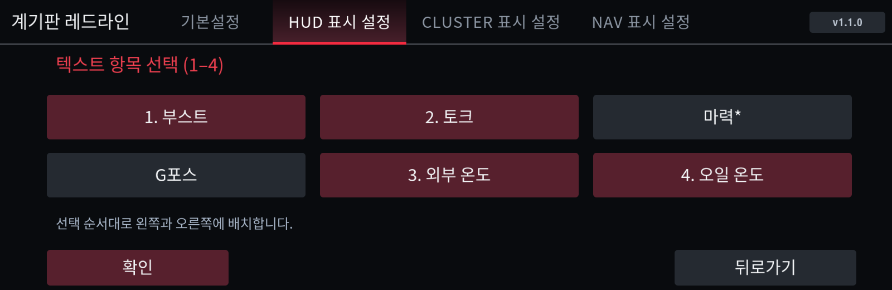
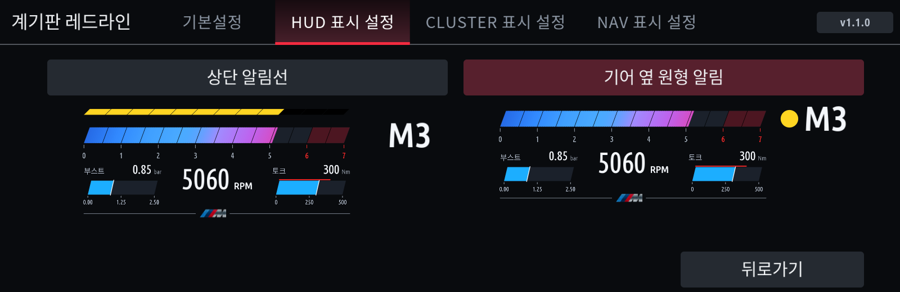
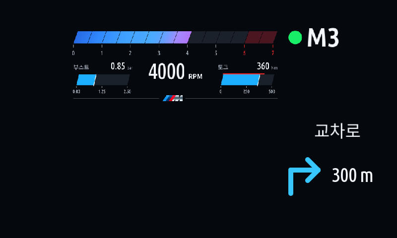

# 계기판 레드라인 사용 안내

현재 스토어 배포 버전은 **1.1.0**입니다. 이전 버전의 변경 내용은 [업데이트 이력](https://github.com/jaimeen77-cmyk/apps/blob/main/CHANGELOG.md)에서 확인합니다.

## 설치와 실행

MGU Store에 `jaimeen77-cmyk/apps` / `main` 소스를 등록하고 새로고침한 뒤 한국어 또는 English판을 설치합니다. **클러스터 렌더러(cluster-render) 0.4.0 이상**이 필요합니다. 소스 등록 방법은 [스토어 안내](MGU-STORE.ko.md)를 참고하세요.

기본설정의 **앱 자동 켜짐**은 다음 앱 시작 시의 동작을 정합니다. **앱 켜기 / 앱 끄기**는 현재 표시 작업을 시작하거나 중지합니다. 끈 뒤에도 설정 화면에서 다시 켤 수 있습니다.

설치 오류는 [설치 실패 확인](REDLINE-INSTALL-FAILED.ko.md), 출력 문제의 상태·로그 수집은 [진단 안내](COLLECT-CLUSTER-REDLINE.ko.md)를 참고하세요. PC 빌드는 [소스 통합·설치 안내](JAM-INTEGRATION.ko.md)를 사용합니다.

## 기본설정

차량 프리셋, 토크·마력 단위, 변속 알림 RPM을 선택합니다. 프리셋은 표시 눈금이며 차량 제원을 자동 인식하는 기능은 아닙니다. 기본 변속 알림은 가솔린·eDrive·M 5500rpm, 디젤 4200rpm입니다. 직접 저장한 RPM은 유지합니다.

계기판 중심 표시 영역은 지도 보기 또는 꺼짐으로 설정합니다. Assist/경로 미리보기의 가림과 복귀 동작은 차량에서 확인해야 합니다.

## HUD 표시 설정 / CLUSTER 표시 설정

기존 상세설정 탭을 없애고 HUD와 CLUSTER의 표시 설정을 분리했습니다.

- **스포츠 모드 RPM 표시:** 스포츠 계열 모드에서 순정 / 레드라인 앱을 고릅니다.
- **모든 모드 RPM 표시:** 모든 유효한 주행 모드에서 순정 / 레드라인 앱을 고릅니다. 모든 모드에 앱 표시를 고르면 스포츠에도 적용됩니다.
- **부가정보:** 부스트·토크·마력·G포스·외부 온도·오일 온도에서 고릅니다. HUD와 CLUSTER는 별도로 기억합니다. 기본은 부스트·토크 게이지입니다.
- **디자인 변경:** 상단 알림선 / 기어 왼쪽의 원형 알림 중에서 실제 RPM 화면 미리보기를 보고 고릅니다. 기본은 원형입니다.
- **위치 / 크기:** RPM 게이지·기어 단수·RPM 알림·부가정보·RPM 수치를 각각 선택해 이동·확대합니다. 좌표 옆에는 선택 영역의 실제 출력 가로×세로 픽셀 크기를 표시합니다. 가로·세로 배율 비율은 최대 1.3배 차이로 제한합니다.

### 부가정보 선택과 저장

게이지 / 텍스트를 누르면 선택되지 않은 새 임시 목록이 열립니다. 항목을 누른 순서대로 번호가 표시되며, **확인(OK)을 눌러야** 화면 방식과 선택 항목이 함께 저장됩니다. 뒤로가기나 탭 이동으로 나오면 기존 값이 유지됩니다.

- 게이지는 1~2개를 선택합니다. 1개는 RPM 왼쪽, 2개는 왼쪽 1번·오른쪽 2번입니다. 온도 항목은 다른 게이지와 같은 영역에 온도계 모양으로 표시합니다.
- 텍스트는 1~4개를 선택합니다. 1개는 왼쪽, 2개는 왼쪽 1번·오른쪽 2번입니다. 3개는 왼쪽 1·2번·오른쪽 3번, 4개는 왼쪽 1·2번·오른쪽 3·4번입니다.
- 신호가 없거나 오래되면 `--`로 표시합니다. G포스는 유효한 두 축으로 계산하며, 마력은 엔진 토크와 RPM으로 계산한 값입니다. eDrive 전기모터 합산 출력은 아닙니다.

### 원형 변속 알림

원은 기어 글자 높이의 70%이며 색이 채워집니다. 낮은 RPM에서는 보이지 않고, 기존 변속 알림 구간에 들어가면 초록 → 노랑 → 깜빡이는 빨강으로 바뀝니다. 기본 변속 기준이 5500rpm이면 첫 초록은 약 3735rpm, 노랑은 4675rpm, 빨강은 5500rpm부터입니다. 기어 신호가 없을 때에도 알림이 작은 점으로 축소되지 않도록 기준 글자 크기를 사용합니다.

기존 기본 상단선 설정은 개편 첫 실행 시 원형으로 바꾸고, 그 후 사용자가 고른 디자인은 재시작해도 유지합니다.

## NAV 표시 설정

- **길안내 표시:** 모든 모드 / 스포츠 제외 중에서 고릅니다. 이 설정은 앱 길안내에 적용됩니다. 순정 안내의 표시 우선순위는 유지합니다.
- **길안내 색상:** 연한 회색·흰색·파란색 화살표 샘플 중에서 고릅니다. 안내 문구와 거리는 흰색입니다.
- **위치 / 크기:** 방향(화살표·거리) / 텍스트(현재 안내 문구)를 각각 선택합니다. 두 영역의 위치와 크기는 독립적이며, 각 영역의 가로·세로는 같은 배율로 조절합니다.

길안내 기본 위치는 RPM 게이지 오른쪽 끝보다 조금 바깥쪽입니다. 기존 설치에도 새 위치를 한 번 적용하고, 이후 위치 조절 값은 유지합니다.

현재 안내에서 받은 한글 설명문을 방향 그림 위에 표시합니다. 다음 안내로 바뀌면 문구도 함께 바뀌며, 안내 종료·연결 해제·정보 만료 시 이전 문구를 재사용하지 않습니다. 별도 도착지 목록을 읽어 목적지 이름을 보충하는 기능은 아닙니다. English판에도 수신 한글 표시용 글꼴을 포함합니다.

RPM 표시가 순정이어도 앱 길안내만 표시하도록 출력 경로를 분리했습니다. 지원하지 않는 안내 종류나 신뢰할 수 없는 데이터에서는 방향을 추측하지 않고 순정 안내에 양보합니다. 이때 레드라인 HUD도 양보할 수 있습니다.

고속도로 진입·진출에서는 수신된 좌·우·직진 방향, 알림 문구와 남은 거리를 표시합니다. 방향 그림은 앱이 그리는 개념도이며 실제 차선 수·도로 형상이나 순정 교차로 확대 이미지를 재현하지 않습니다. CarPlay 지도·추천 차선·교차로 그림은 아직 수신을 확인하지 않았습니다.

## 검증과 배포 파일

한국어·영어 화면, 실제 설정 호스트와 입력 경로, 선택·취소·저장, 신호 변환·만료, 한글 갱신, 위치·비율 제한, 차분 갱신 및 순정 안내 양보를 호스트에서 검사했습니다. 새 부가정보와 UI의 실차 확인은 남아 있습니다.

공개 저장소에는 SDK가 없는 템플릿과 소스만 제공합니다. 본인 SDK가 포함된 PC 설치 키트는 공개 공유하지 마세요.
