# Cluster Redline 1.2.0 user guide

[한국어](CLUSTER-REDLINE.ko.md) · [Installation](INSTALL.md) · [All screenshots](../screenshots/README.md) · [Changelog](../CHANGELOG.md)

Display RPM, gear and shift alerts on the cluster/HUD, with received navigation guidance alongside HUD RPM. Images below are **actual app renders with example data**, not measurements or photographs from a vehicle.

## Basic settings

- **App auto start:** operation at the next app-process launch.
- **Start app / Stop app:** start/stop the live worker now; settings remain available.
- **Vehicle preset:** Petrol, Diesel, eDrive or M display scales; it does not discover vehicle specifications.
- **Power / Torque unit:** display units.
- **Shift alert RPM:** use a preset or your own threshold. Defaults are 5500rpm for Petrol/eDrive/M, 4200rpm for Diesel.

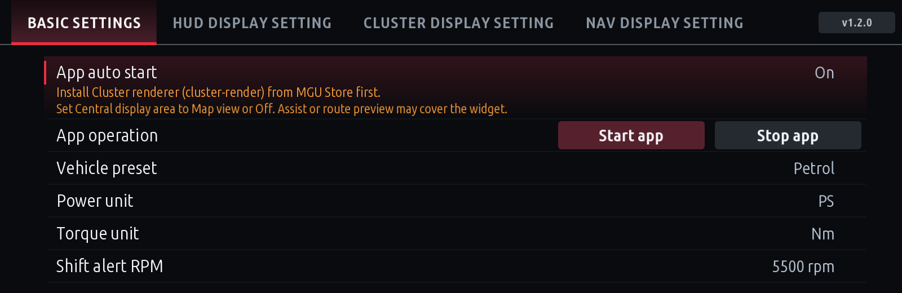

## Separate HUD / CLUSTER output choices

| Setting | Behavior |
|---|---|
| Sport mode RPM display | Stock / Redline for Sport variants |
| All modes RPM display | Choice covering all valid modes, including Comfort Plus and Eco variants |

**All modes Redline also applies in Sport.** For Sport only, choose Sport=Redline and All=Stock. Defaults are Sport cluster output and Stock HUD RPM.

## Two alert designs

Open **Design** and choose using the live RPM previews.

- **Circle beside gear:** the HUD gear and filled circle share one position/scale control. The circle HUD face is lowered by two existing source-coordinate steps (+20px).
- **Top alert bar:** gear and alert-bar position/scale remain independent.

The circle diameter is 70% of gear glyph height. It stays hidden at low RPM, then progresses green → yellow → flashing red. With a 5500rpm threshold, first green is about 3735rpm, yellow 4675rpm and red 5500rpm. Red phases switch every 250ms; RPM digits stay red. **Red screenshots show the on phase.**

| HUD circle | HUD bar |
|---|---|
| 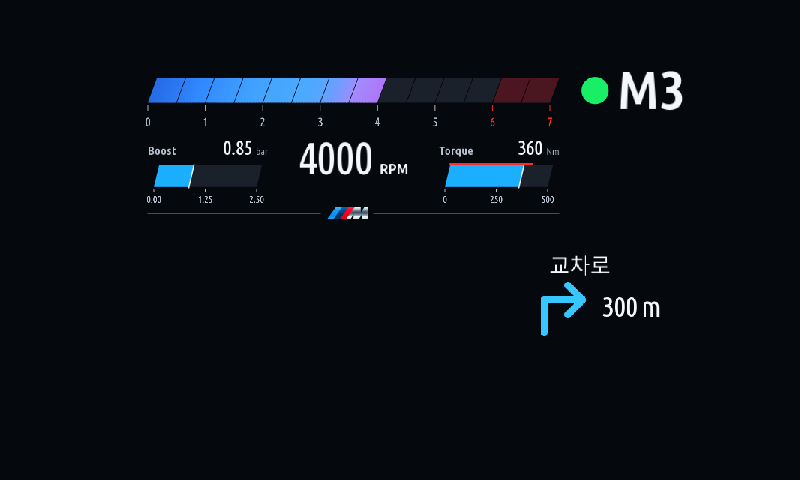 | 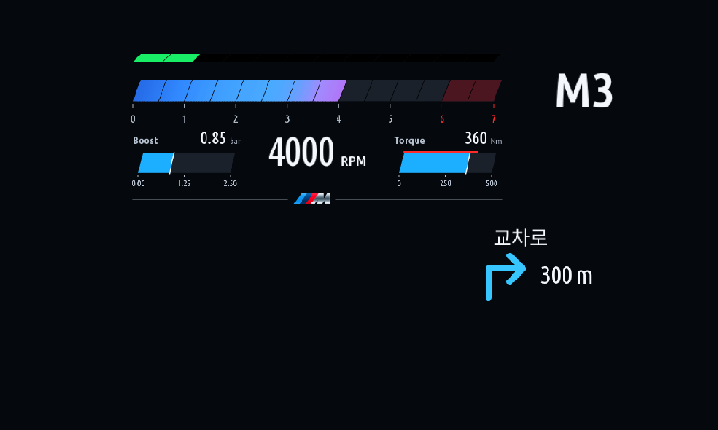 |

| Cluster circle | Cluster bar |
|---|---|
| 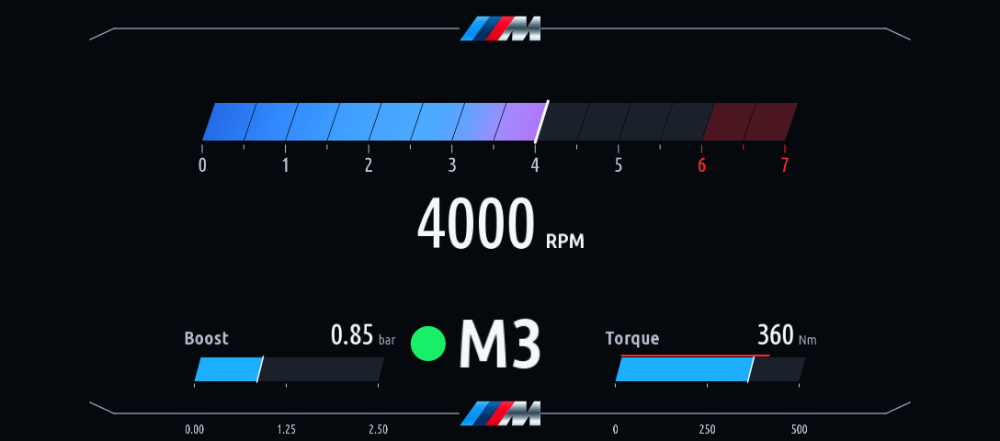 | 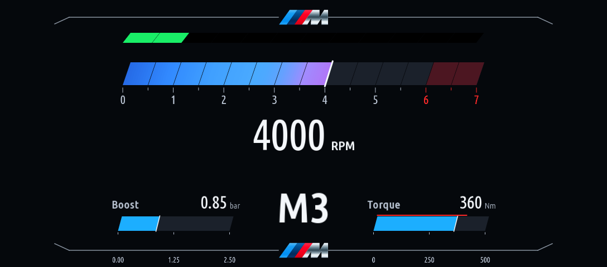 |

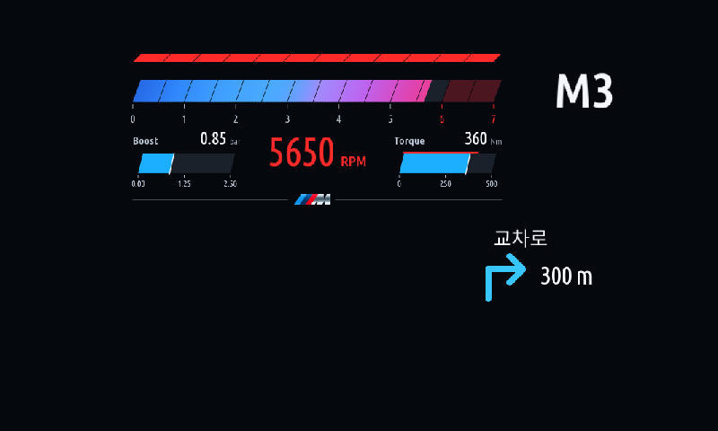
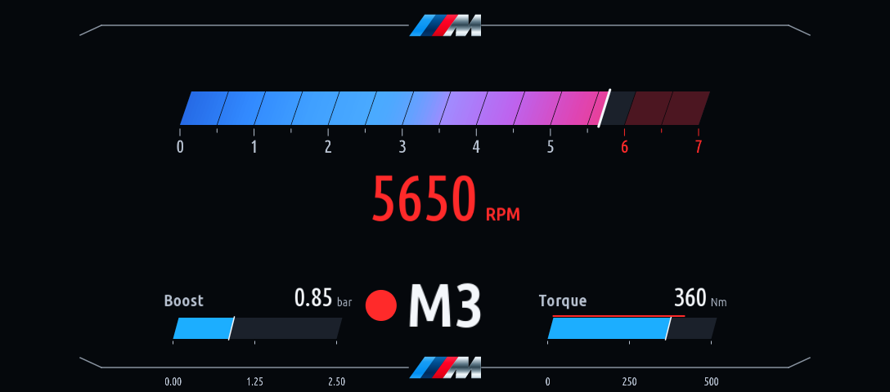

## Auxiliary information

Choose **Auxiliary information → Gauges / Text → items → OK**. Selection starts as an empty draft; items are numbered in tap order. Back or switching tabs discards the draft. Only OK commits the mode and ordered items.

| Metric | Gauge-mode appearance | Meaning |
|---|---|---|
| Boost | Bar | Received boost pressure in bar |
| Torque | Bar | Engine torque in the selected unit |
| Power* | Bar | Output estimated from engine torque and RPM |
| G-force | Filled dot in a rectangular track | Value is the two-axis magnitude; dot follows lateral acceleration |
| Outside temperature | Thermometer | Received ambient temperature |
| Oil temperature | Thermometer | Received engine-oil temperature |
| 12 V battery charge | Battery icon | 12V SOC%, not high-voltage traction-battery charge |
| Battery voltage | Text | Voltage from supported standard read requests |
| Average fuel economy | Text | Vehicle trip-1 average converted to km/L |

**Voltage and economy remain text even in Gauges mode.** Power* is an estimate and excludes combined electric-motor output. Voltage reads are bounded and run only for a selected active output with recent engine activity. Missing/stale values show `--`.

- One gauge: left. Two: item 1 left / item 2 right.
- One text item: left. Two: item 1 left / item 2 right.
- Three: items 1–2 left / item 3 right. Four: items 1–2 left / items 3–4 right.

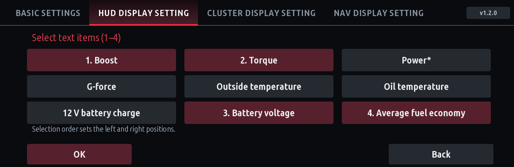
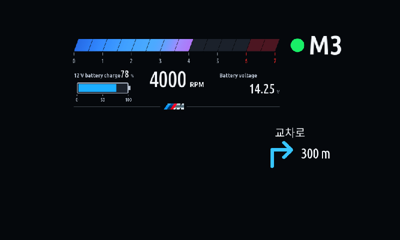
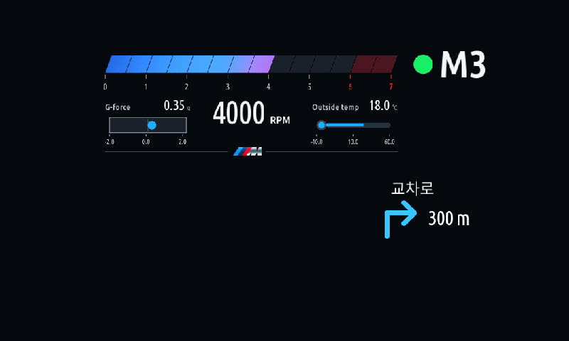

## Position, size, M marks and lines

In **Position / size**, choose an element and use the direction/size buttons. X/Y are **offsets from its base layout**; width × height is the output region in pixels. Overall HUD/cluster scaling also applies, so a source-coordinate offset need not equal final screen pixels.

| HUD circle | HUD bar | CLUSTER |
|---|---|---|
| RPM gauge, Gear + circle alert, Auxiliary left/right, RPM number, M mark | RPM gauge, Gear, RPM alert, Auxiliary left/right, RPM number, M mark | RPM gauge, Gear, RPM alert, Auxiliary left/right, RPM number, Upper/Lower M mark |

Left/right auxiliary groups move independently, including two text items together on each side. Both cluster designs default each auxiliary group to **(0,50)**.

Select an M mark to reveal **Hide line / Hide M mark**. Each toggles independently and can be shown again. Cluster upper/lower marks have separate controls. **Moving an M leaves its decorative line anchored.** Width/height scale ratios are limited to 1.3.

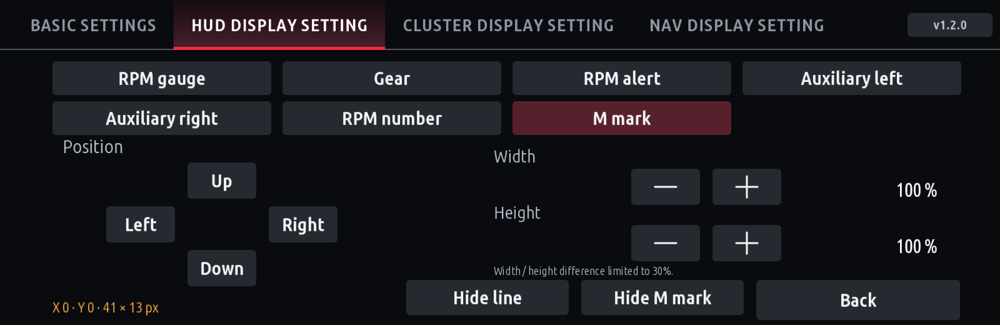
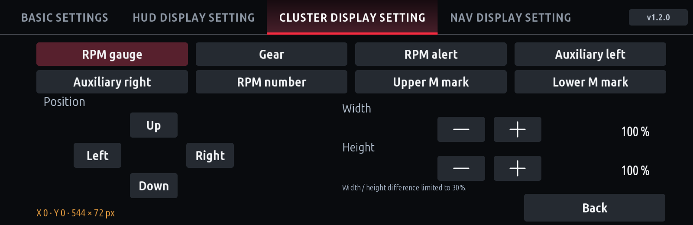

## NAV display setting

- **Guidance display:** All modes / Except Sport. NAV may run separately while HUD RPM is Stock.
- **Design:** gray, white or blue arrows; descriptions and distances remain white.
- **Position:** select Direction or Text. Each moves/scales independently; its width and height scale uniformly.

| Region | Default X/Y offset | Size | Scale |
|---|---|---|---|
| Text | (180,10) | 156×31px | 65% |
| Direction/distance | (210,30) | 168×78px | 70% |

The received current-maneuver description appears above the arrow and updates with the next instruction. English UI can display received Hangul text. Previous instructions are cleared on route/source loss or expiry.

Supported diagrams include turns, straight/slight/fork directions, U-turns, roundabouts, lane-change arrows, arrivals and six highway entry/exit variants. A lane-change arrow is **not a recommended-lane picture**. These diagrams do not reproduce map video, junction images or tunnel-specific pictures. Unsupported guidance yields to stock. Delivery varies by map app, phone and vehicle.

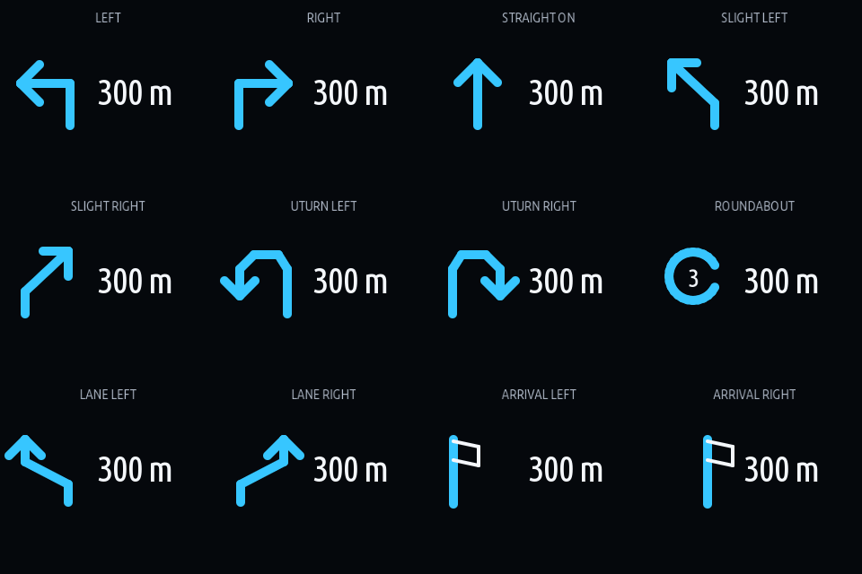
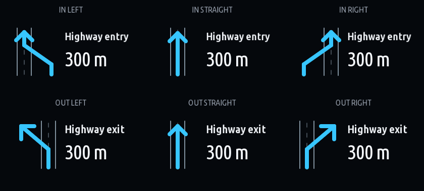
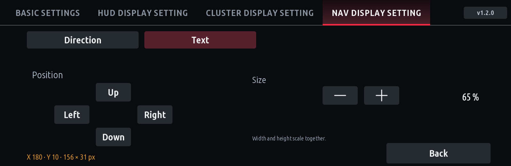

## Validation scope

Rendering, settings and optional installation interfaces are host-tested. Battery/economy delivery, Assist recovery and final combined-HUD placement still need real-vehicle checks for this release. See [installation/troubleshooting](INSTALL.md) and the [log guide](COLLECT-CLUSTER-REDLINE.ko.md) for problems.
