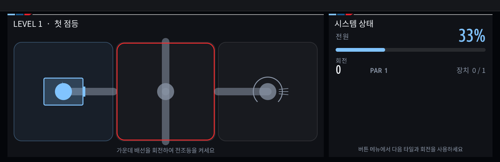

# iDrive Circuit for BMW iDrive 7

[English](README.md) | 한국어

BMW MGU / iDrive 7 커스텀 앱 환경에서 실행되는 주차 전용 회로 퍼즐입니다. 회로 타일을 회전해 배터리의 전력을 모든 차량 모듈에 연결하면 됩니다.



## 주요 기능

- 튜토리얼을 포함한 30개 레벨
- 터치와 iDrive 컨트롤러 조작
- 전력 전파·끊어진 연결·완료 상태 실시간 표시
- Undo, Hint, Restart, PAR 및 1~3성 평가
- 현재 퍼즐, 최고 기록과 해금 상태 자동 저장
- 네 가지 화면 테마와 GPU 60fps 렌더러 지원
- GPU를 사용할 수 없을 때 소프트웨어 렌더링 지원
- 기본값이 **Parked only**이며 차량이 3km/h를 넘으면 퍼즐 입력 잠금
- 한국어 메뉴와 게임 상태 표시

이 게임의 회로는 전부 시뮬레이션입니다. 차량의 SOME/IP 또는 UDS 값을 변경하지 않습니다.

## 중요한 안내

이 저장소는 [cauliflowermossgrape/idrive7-apps](https://github.com/cauliflowermossgrape/idrive7-apps)에 추가하는 소스 오버레이입니다. 단독으로 차량에 설치할 수 없습니다.

- BMW와 무관한 비공식 취미 프로젝트입니다.
- 차량 MGU의 root shell 접근 권한이 필요하지만, 이 저장소는 root 획득 방법을 제공하지 않습니다.
- BMW OAP SDK는 저작권이 있는 차량 소유자 파일이므로 포함하지 않습니다.
- 차량 키, VIN, provisioning 파일도 포함하지 않습니다.
- 먼저 upstream 프로젝트의 `check` 명령을 실행하고, 차량을 운전하면서 게임을 조작하지 마세요.

## 준비 사항

1. MGU 헤드유닛이 장착된 BMW iDrive 7 차량
2. 헤드유닛 root shell 접근
3. Windows, macOS 또는 Linux PC
4. Python 3.6 이상, Node.js 14 이상, OpenSSH
5. 자신의 헤드유닛에서 추출한 `oap-sdk/`

자세한 환경 요구사항과 SDK 추출 절차는 [upstream README](https://github.com/cauliflowermossgrape/idrive7-apps#2-what-you-need)를 따르세요.

## 1. 소스 합치기

두 저장소를 나란히 받습니다.

```powershell
git clone https://github.com/cauliflowermossgrape/idrive7-apps.git
git clone https://github.com/jaimeen77-cmyk/idrive7-apps-jam.git
cd idrive7-apps-jam
```


자동 설치 스크립트로 게임 파일과 한국어 번역을 upstream 작업 폴더에 합칩니다.

```powershell
python tools\install-overlay.py ..\idrive7-apps
```

macOS/Linux도 동일합니다.

```bash
python3 tools/install-overlay.py ../idrive7-apps
```

혹은 그냥 경로를 바꿔서 복사해 넣어주면 됩니다.
```
idrive7-apps-jam/apps/idrive_circuit
→
idrive7-apps/apps/idrive_circuit
```
Windows PowerShell:

```powershell
Copy-Item -Recurse .\idrive7-apps-jam\apps\idrive_circuit .\idrive7-apps\apps\
```

macOS/Linux:

```bash
cp -R idrive7-apps-jam/apps/idrive_circuit idrive7-apps/apps/
```

옵션
```text
kit/icons/idrive_circuit.svg
kit/tools/test_idrive_circuit.js
```


### 위의 작업 자동화
대상 폴더에 기존 `apps/idrive_circuit`이 있으면 스크립트가 중지합니다. 이 저장소 버전으로 갱신하려면 내용을 먼저 확인한 뒤 `--force`를 사용하세요.

```powershell
python tools\install-overlay.py ..\idrive7-apps --force
```

macOS/Linux:

```bash
cd idrive7-apps-jam
python3 tools/install-overlay.py ../idrive7-apps
```


한국어 번역을 합치지 않으려면 `--no-ko`를 추가할 수 있습니다.

## 2. BMW OAP SDK 준비

upstream 저장소의 안내에 따라 자신의 헤드유닛에서 `x_call` 앱을 복사하고 SDK를 추출합니다. 아래 결과가 upstream 저장소 안에 있어야 합니다.

```text
idrive7-apps/
└─ oap-sdk/
   ├─ index.js
   ├─ package.json
   └─ source/
```

`oap-sdk/` 또는 SDK가 포함된 `.mgu` 파일을 GitHub에 올리지 마세요.

## 3. PC에서 테스트

upstream `idrive7-apps` 폴더에서 실행합니다.

```powershell
node kit\tools\test_idrive_circuit.js
python kit\tools\build.py --language ko --preview-only idrive_circuit
node kit\tools\preview.js dist\idrive_circuit preview\idrive_circuit frames=3
```

실시간 브라우저 에뮬레이터:

```powershell
node kit\tools\emu.js idrive_circuit
```

브라우저에서 `http://localhost:8077`을 열면 됩니다. 마우스는 터치, 휠 또는 `[`/`]`는 노브 회전, `Enter`는 노브 누름, 방향키는 노브 밀기입니다.

## 4. 설치 키트 만들기

Windows:

```powershell
deploy\make-car-kit.cmd idrive_circuit

deploy\make-car-kit.cmd --language ko idrive_circuit
```

macOS/Linux/WSL:

```bash
deploy/make-car-kit.sh idrive_circuit
```

완성된 키트는 upstream 저장소의 `dist/`에 생성됩니다.

## 5. 차량 호환성 확인 및 설치

Windows PowerShell:

```powershell
powershell -ExecutionPolicy Bypass -File deploy\push-to-car.ps1 check `
  -Key <SSH-개인키-경로> -Ip <헤드유닛-IP>

powershell -ExecutionPolicy Bypass -File deploy\push-to-car.ps1 install `
  -Key <SSH-개인키-경로> -Ip <헤드유닛-IP>


powershell -ExecutionPolicy Bypass -File deploy\push-to-car.ps1 check `
  -Kit dist\mgu-custom-apps-ko.tar.gz `
  -Key <SSH키> -Ip <헤드유닛IP>

powershell -ExecutionPolicy Bypass -File deploy\push-to-car.ps1 install `
  -Kit dist\mgu-custom-apps-ko.tar.gz `
  -Key <SSH키> -Ip <헤드유닛IP>
```

macOS/Linux/WSL:

```bash
HU=root@<헤드유닛-IP> KEY=<SSH-개인키-경로> deploy/push-to-car.sh check
HU=root@<헤드유닛-IP> KEY=<SSH-개인키-경로> deploy/push-to-car.sh install
```

`check`가 오류를 보고하면 설치하지 말고 먼저 원인을 해결하세요. 설치 후 약 1~2분 뒤 Apps 메뉴에 **iDrive Circuit** 타일이 표시됩니다.

## 조작법

### GPU 전체 화면

- 노브 회전: 타일 순서대로 이동
- 노브 상하좌우 밀기: 화면에서 해당 방향의 타일로 이동
- 노브 누르기: 선택 타일을 시계 방향으로 90도 회전
- 터치: 누른 타일을 바로 회전

### 표준/소프트웨어 화면

- **Next tile**: 다음 타일 선택
- **Rotate**: 선택 타일 회전
- **Undo**, **Hint**, **Restart**, **Previous level**, **Next level**: 동일하게 사용

## 원상 복구

upstream 프로젝트의 `restore`는 모든 커스텀 앱과 관련 hook을 제거하고 최초 백업 상태로 되돌립니다.

Windows:

```powershell
powershell -ExecutionPolicy Bypass -File deploy\push-to-car.ps1 restore `
  -Key <SSH-개인키-경로> -Ip <헤드유닛-IP>
```

macOS/Linux/WSL:

```bash
HU=root@<헤드유닛-IP> KEY=<SSH-개인키-경로> deploy/push-to-car.sh restore
```

## 저장소 구성

```text
apps/idrive_circuit/            게임 앱 소스와 아이콘
kit/icons/idrive_circuit.svg    앱 타일 원본 SVG
kit/tools/test_idrive_circuit.js
localization/ko-additions.tsv   한국어 번역 추가분
tools/install-overlay.py        upstream 폴더에 안전하게 합치는 스크립트
screenshots/                    실제 오프라인 렌더링 결과
```

## 라이선스와 출처

이 게임 소스는 MIT 라이선스입니다. 기반 런타임과 설치 방식은 [cauliflowermossgrape/idrive7-apps](https://github.com/cauliflowermossgrape/idrive7-apps)를 사용합니다. upstream 저장소의 renderer와 기타 구성요소에는 별도 라이선스가 적용될 수 있으므로 해당 저장소의 라이선스 안내도 확인하세요.


